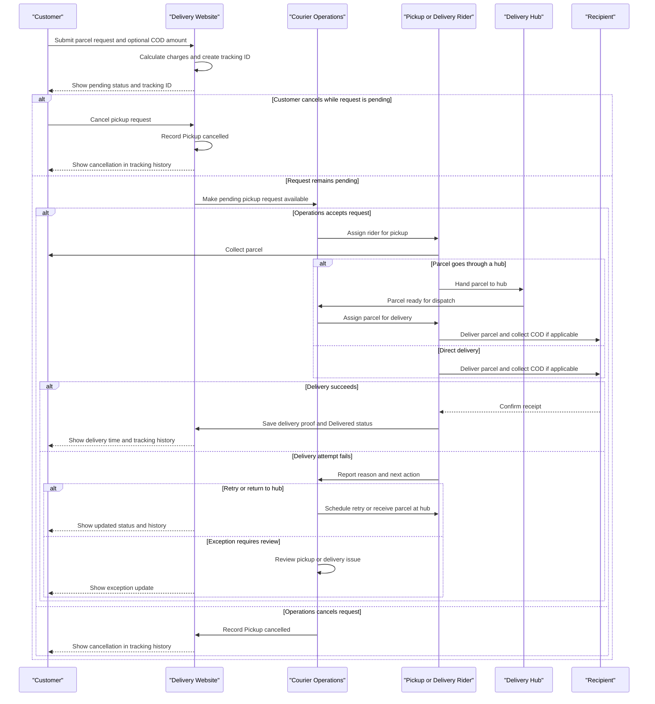

# Customer Parcel Lifecycle

এই নথিতে Delivery Fast-এর customer parcel বুকিং থেকে চূড়ান্ত ডেলিভারি পর্যন্ত ধাপগুলো বর্ণনা করা হয়েছে। ওয়েবসাইট, Courier Operations এবং Rider workspace-এ দেখানো flow অনুযায়ী parcel-এর status ও tracking history আপডেট হয়।

## Lifecycle-এর ধাপ

1. **Pickup request তৈরি** — গ্রাহক pickup ও delivery address, sender ও recipient-এর তথ্য, parcel-এর ধরন, ওজন, packaging এবং service level দেন। Cash on delivery (COD) চাইলে সংগ্রহের অঙ্কও উল্লেখ করেন।
2. **Charge হিসাব ও tracking ID** — delivery charge-এ প্রযোজ্য base, weight, service ও COD fee যোগ হয়। delivery charge sender-এর; COD থাকলে নির্দিষ্ট অঙ্ক receiver-এর কাছ থেকে সংগ্রহের জন্য রাখা হয়। request জমা হলে একটি tracking ID তৈরি হয় এবং প্রাথমিক status হয় `Pending operations confirmation`।
3. **Operations-এর সিদ্ধান্ত** — Courier Operations request পর্যালোচনা করে pickup rider assign করে (`Pickup assigned`) অথবা request বাতিল করে (`Pickup cancelled`)। Operations নিশ্চিত করার আগে গ্রাহক নিজে request বাতিল করতে পারেন; এরপর online cancellation আর খোলা থাকে না।
4. **Pickup** — assigned rider parcel সংগ্রহ করে। parcel hub-এ জমা হলে status `At hub` হয়; rider সরাসরি recipient-এর কাছে নিয়ে গেলে `Out for delivery` হয়। pickup সম্পন্ন না হলে `Exception` দিয়ে Operations-এর review চাওয়া যায়।
5. **Hub ও যাত্রাপথ** — hub-এ থাকা parcel delivery-এর জন্য rider-কে assign করা হয় (`Assigned`)। এরপর parcel `In transit` হয়ে destination hub বা delivery area-র দিকে এগোয়; tracking history-তে প্রতিটি update যোগ হয়।
6. **শেষ মাইল ও delivery attempt** — rider parcel নিয়ে recipient-এর ঠিকানায় যান (`Out for delivery`)। সফল হলে delivery proof—signature, OTP বা photo—নথিভুক্ত করে status `Delivered` করেন। COD থাকলে recipient-এর কাছ থেকে নির্ধারিত টাকা সংগ্রহ করা হয়।
7. **ব্যর্থ প্রচেষ্টা ও পুনরায় ব্যবস্থা** — delivery সম্ভব না হলে rider failure reason ও পরবর্তী পদক্ষেপ বেছে নেন। আবার চেষ্টা করার জন্য `Retry scheduled`, hub-এ ফেরত দিলে `At hub` status হয়। pickup বা delivery-সংক্রান্ত `Exception` Operations-এর review-তে যায়।
8. **Tracking ও সমাপ্তি** — গ্রাহক tracking ID দিয়ে latest status, location, estimated arrival এবং event history দেখতে পারেন। `Delivered` হলে delivery time ও proof of delivery tracking-এ দেখা যায়; signature বা photo-র মতো proof detail দেখতে sender-কে sign-in করতে হতে পারে।

## Status-গুলোর সাধারণ ক্রম

`Pending operations confirmation` → `Pickup assigned` → `At hub` → `Assigned` / `In transit` → `Out for delivery` → `Delivered`

কিছু parcel hub বাদ দিয়ে সরাসরি delivery-তে যেতে পারে (`Pickup assigned` → `Out for delivery`)। `Pickup cancelled`, `Exception`, `Retry scheduled` এবং `Return scheduled` হলো বিকল্প outcome; এগুলো স্বাভাবিক সফল delivery-ক্রমের অংশ নয়।

## Lifecycle sequence

<!-- mermaid-checked: every participant uses `participant Id as "Label"`, no \n in aliases/messages/notes, every alt/opt/loop closed by end, no `:` inside any alias -->

## COD ও delivery proof

- COD ঐচ্ছিক; booking-এর সময় amount দেওয়া হয়। COD না থাকলে receiver-এর কাছ থেকে parcel-এর দাম সংগ্রহের কথা নয়।
- COD amount, COD fee এবং sender-এর delivery fee আলাদা হিসেবে দেখানো হয়। Merchant payout বা final settlement-এর শর্ত merchant plan-এর ওপর নির্ভর করে।
- `Delivered` status দেওয়ার আগে rider-কে delivery proof দিতে হয়: signature, demo OTP (`4810`) যাচাই, অথবা photo upload। এগুলো এই demo-তে ব্যবহৃত verification পদ্ধতি।

## Demo-র সীমাবদ্ধতা

এটি browser-based presentation demo, production courier backend নয়। Customer parcel ও event history browser-এর `localStorage`-এ এবং কিছু tracking sample `sessionStorage`-এ রাখা হয়; আলাদা browser বা device-এ এগুলো স্বয়ংক্রিয়ভাবে synchronize হওয়ার নিশ্চয়তা নেই। তাই status, charge, COD settlement ও delivery proof-কে বাস্তব লেনদেনের রেকর্ড হিসেবে ব্যবহার করা যাবে না।
