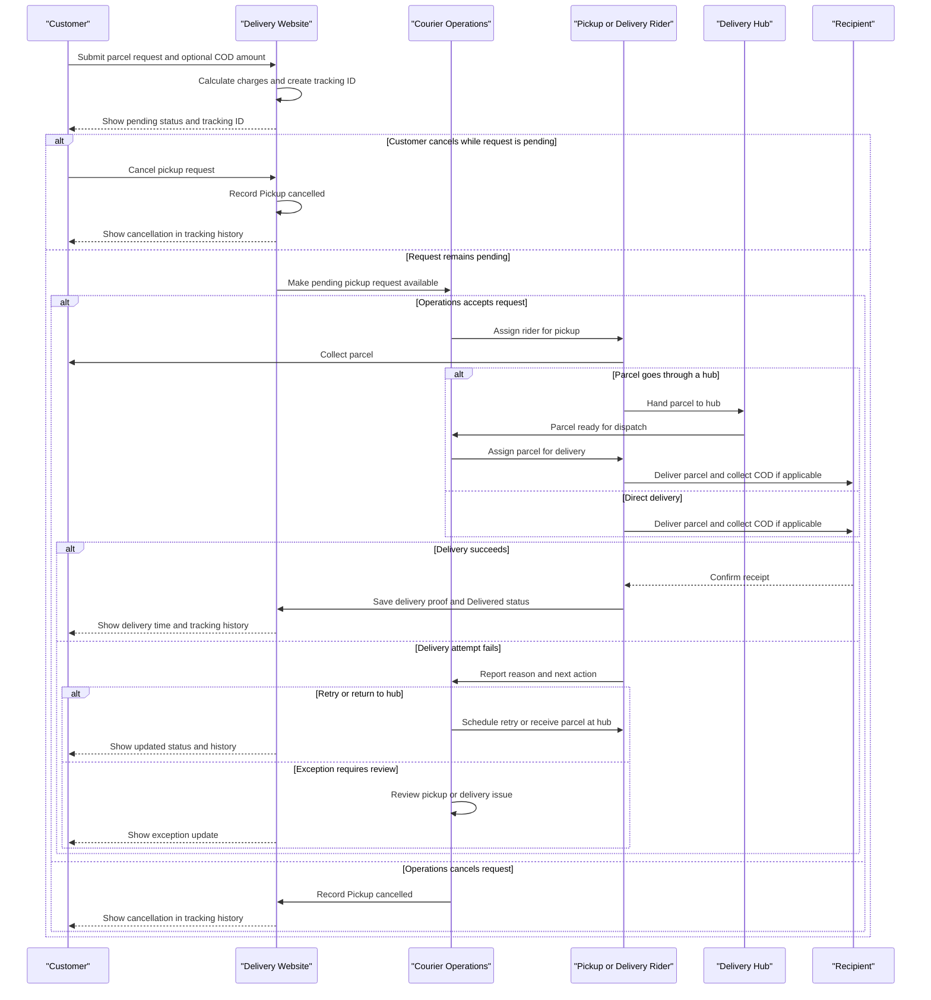

# Customer Parcel Lifecycle

এই নথিতে Delivery Fast-এর customer parcel বুকিং থেকে চূড়ান্ত ডেলিভারি পর্যন্ত ধাপগুলো বর্ণনা করা হয়েছে। ওয়েবসাইট, Courier Operations এবং Rider workspace-এ দেখানো flow অনুযায়ী parcel-এর status ও tracking history আপডেট হয়।

## Lifecycle-এর ধাপ

1. **Pickup request তৈরি** — গ্রাহক pickup ও delivery address, sender ও recipient-এর তথ্য, parcel-এর ধরন, ওজন, packaging এবং service level দেন। Cash on delivery (COD) চাইলে সংগ্রহের অঙ্কও উল্লেখ করেন।
2. **Charge হিসাব ও tracking ID** — delivery charge-এ প্রযোজ্য base, weight, service ও COD fee যোগ হয়। delivery charge sender-এর; COD থাকলে নির্দিষ্ট অঙ্ক receiver-এর কাছ থেকে সংগ্রহের জন্য রাখা হয়। request জমা হলে একটি tracking ID তৈরি হয় এবং প্রাথমিক status হয় `Pending operations confirmation`।
3. **Operations-এর সিদ্ধান্ত** — Courier Operations request পর্যালোচনা করে pickup rider assign করে (`Pickup assigned`) অথবা request বাতিল করে (`Pickup cancelled`)। Operations নিশ্চিত করার আগে গ্রাহক নিজে request বাতিল করতে পারেন; এরপর online cancellation আর খোলা থাকে না।
4. **Pickup** — assigned rider parcel সংগ্রহ করে। parcel hub-এ জমা হলে status `At hub` হয়; rider সরাসরি recipient-এর কাছে নিয়ে গেলে `Out for delivery` হয়। pickup সম্পন্ন না হলে `Exception` দিয়ে Operations-এর review চাওয়া যায়।
5. **Hub ও যাত্রাপথ** — hub-এ থাকা parcel delivery-এর জন্য rider-কে assign করা হয় (`Assigned`)। এরপর parcel `In transit` হয়ে destination hub বা delivery area-র দিকে এগোয়; tracking history-তে প্রতিটি update যোগ হয়।
6. **শেষ মাইল ও delivery attempt** — rider parcel নিয়ে recipient-এর ঠিকানায় যান (`Out for delivery`)। সফল হলে delivery proof—signature, OTP বা photo—নথিভুক্ত করে status `Delivered` করেন। COD থাকলে recipient-এর কাছ থেকে নির্ধারিত টাকা সংগ্রহ করা হয়।
7. **ব্যর্থ প্রচেষ্টা ও পুনরায় ব্যবস্থা** — delivery সম্ভব না হলে rider failure reason ও পরবর্তী পদক্ষেপ বেছে নেন। আবার চেষ্টা করার জন্য `Retry scheduled`, hub-এ ফেরত দিলে `At hub` status হয়। pickup বা delivery-সংক্রান্ত `Exception` Operations-এর review-তে যায়।
8. **Tracking ও সমাপ্তি** — গ্রাহক tracking ID দিয়ে latest status, location, estimated arrival এবং event history দেখতে পারেন। `Delivered` হলে delivery time ও proof of delivery tracking-এ দেখা যায়; signature বা photo-র মতো proof detail দেখতে sender-কে sign-in করতে হতে পারে।

## Status-গুলোর সাধারণ ক্রম

`Pending operations confirmation` → `Pickup assigned` → `At hub` → `Assigned` / `In transit` → `Out for delivery` → `Delivered`

কিছু parcel hub বাদ দিয়ে সরাসরি delivery-তে যেতে পারে (`Pickup assigned` → `Out for delivery`)। `Pickup cancelled`, `Exception`, `Retry scheduled` এবং `Return scheduled` হলো বিকল্প outcome; এগুলো স্বাভাবিক সফল delivery-ক্রমের অংশ নয়।

## Lifecycle sequence

<!-- mermaid-checked: every participant uses `participant Id as "Label"`, no \n in aliases/messages/notes, every alt/opt/loop closed by end, no `:` inside any alias -->


## COD ও delivery proof

- COD ঐচ্ছিক; booking-এর সময় amount দেওয়া হয়। COD না থাকলে receiver-এর কাছ থেকে parcel-এর দাম সংগ্রহের কথা নয়।
- COD amount, COD fee এবং sender-এর delivery fee আলাদা হিসেবে দেখানো হয়। Merchant payout বা final settlement-এর শর্ত merchant plan-এর ওপর নির্ভর করে।
- `Delivered` status দেওয়ার আগে rider-কে delivery proof দিতে হয়: signature, demo OTP (`4810`) যাচাই, অথবা photo upload। এগুলো এই demo-তে ব্যবহৃত verification পদ্ধতি।

## Demo-র সীমাবদ্ধতা

এটি browser-based presentation demo, production courier backend নয়। Customer parcel ও event history browser-এর `localStorage`-এ এবং কিছু tracking sample `sessionStorage`-এ রাখা হয়; আলাদা browser বা device-এ এগুলো স্বয়ংক্রিয়ভাবে synchronize হওয়ার নিশ্চয়তা নেই। তাই status, charge, COD settlement ও delivery proof-কে বাস্তব লেনদেনের রেকর্ড হিসেবে ব্যবহার করা যাবে না।


Panel	URL
Public website	http://localhost:3000/
Courier operations	http://localhost:3000/courier-operation
Rider	http://localhost:3000/rider
E-commerce merchant	http://localhost:3000/ecommerce-merchant
Document merchant	http://localhost:3000/document-merchant
Super admin	http://localhost:3000/super-admin


Your super admin account

Sign-in page: http://localhost:3000/#/login
Email: superadmin@deliveryfast.example (or phone 01700000099)
Password: Admin9fc9308a4eba9


1. Super admin (প্রথম login-এ authenticator app লাগবে)
superadmin@deliveryfast.example
Gzo9a%37+7m7MRHMx7
5EKNM-AYJVN

2. Operations manager
ops.manager@deliveryfast.example
aoTT+AwiZWqEKA%c2r

3. Hub operator (Dhaka Central Sorting)
hubop.dhaka.central@deliveryfast.example
i6HxcvPHP%gCy%4pzN

4. Hub operator (Gulshan)
hubop.gulshan@deliveryfast.example
i6HxcvPHP%gCy%4pzN

5. Hub operator (Chattogram)
hubop.chattogram@deliveryfast.example
i6HxcvPHP%gCy%4pzN

55. 
Name	Tangail Hub Manager
Sign in with (phone)	01711000109
Password	Tng-dhXQoLySMP


55. Dhanmondi hub
dhanmondi@mail.com
01794851236
aCco+6j9Q%?2khoS2Z 

6. Finance (maker)
finance.maker@deliveryfast.example
aCco+6j9Q%?2khoS2Z

7. Finance (checker)
finance.checker@deliveryfast.example
aCco+6j9Q%?2khoS2Z

8. Support agent
support.agent@deliveryfast.example
+t6jktBBg+GATB6wAu

9. E-commerce merchant owner (Shopnil Fashion House)
merchant.ecom.owner@deliveryfast.example
CP3Gk+UfvShbv=%TEY

10. E-commerce merchant staff (Shopnil Fashion House)
merchant.ecom.staff@deliveryfast.example
CP3Gk+UfvShbv=%TEY

11. Document merchant owner (Shapla Corporate Services)
merchant.doc.owner@deliveryfast.example
CP3Gk+UfvShbv=%TEY

12. Customer (Ayesha Siddiqua)
customer.ayesha@deliveryfast.example
EeongQnuknW!gY9g3#

13. Customer (Rafiq Uddin)
customer.rafiq@deliveryfast.example
EeongQnuknW!gY9g3#

14. Rider (R-2101, Abdul Karim, Gulshan)
01811000201
%67u#=pfBSa@auHT+V

15. Rider (R-2102, Jahid Hasan, Gulshan)
01811000202
%67u#=pfBSa@auHT+V

16. Rider (R-2103, Sohel Rana, Mirpur)
01811000203
%67u#=pfBSa@auHT+V

17. Rider (R-2104, Rasel Mia, Mirpur)
01811000204
%67u#=pfBSa@auHT+V

18. Rider (R-2105, Imran Hossain, Uttara)
01811000205
%67u#=pfBSa@auHT+V

19. Rider (R-2106, Arif Billah, Uttara)
01811000206
%67u#=pfBSa@auHT+V

20. Rider (R-2107, Mizanur Rahman, Dhanmondi)
01811000207
%67u#=pfBSa@auHT+V

21. Rider (R-2108, Shakil Ahmed, Dhanmondi)
01811000208
%67u#=pfBSa@auHT+V

22. Rider (R-2109, Nurul Alam, Chattogram)
01811000209
%67u#=pfBSa@auHT+V

23. Rider (R-2110, Fahim Chowdhury, Sylhet)
01811000210
%67u#=pfBSa@auHT+V


The checks confirm the problem is on the server: the df-web process itself returns 404 for the chunk, so Apache is just passing that 404 through. The PM2 synchronization warning is separate and won’t fix the missing asset.

First check whether that exact chunk exists in the build output:


If it exists, copy the build’s static assets into the standalone deployment and restart the web process:


Then verify:


Both should return 200. If the chunk is missing from the build output, rebuild the web app and copy the static files from that same build before restarting. The standalone copy step is also in deployment.md.

Don’t run pm2 save just to address this warning: it only saves the current PM2 process list, which includes unrelated apps.


I’ll check whether `select-search.js` is present in the web app’s public assets and whether pages expect it to load.

Find files matching `apps/web/public/legacy/shared/**`

Search for `select-search\.js|selectSearch|select-search`

"Fetch Web Content" failed
Completed with input: {"url":"https://deliveryfast.imagine-design.net/legacy/shared/select-search.js"}
Tool execution failed: Error: Failed to fetch https://deliveryfast.imagine-design.net/legacy/shared/select-search.js - status code 404

Fetched [https://deliveryfast.imagine-design.net/](https://deliveryfast.imagine-design.net/)
Completed with input: {
  "url": "https://deliveryfast.imagine-design.net/",
  "max_length": 6000,
  "raw": true
}

The file exists in the repository at `select-search.js`, and several page bundles load it. The public 404 therefore points to the deployed standalone app having an outdated or incomplete `public` directory.

On the server, from `/home/parcel2026`, copy the current public assets into the standalone app and restart its PM2 process:

```bash
cd /home/parcel2026
mkdir -p apps/web/.next/standalone/apps/web/public
cp -a apps/web/public/. apps/web/.next/standalone/apps/web/public/
pm2 restart df-web
```

Then verify both the app and domain serve the file:

```bash
curl -sS -o /dev/null -w 'local:  %{http_code}\n' \
  http://127.0.0.1:3001/legacy/shared/select-search.js

curl -sS -o /dev/null -w 'public: %{http_code}\n' \
  https://deliveryfast.imagine-design.net/legacy/shared/select-search.js
```

Both should return `200`. This is separate from the earlier `/_next/static` chunk fix: Next.js serves those from `.next/static`, while this script is served from `public`. The deployment guide’s release steps include copying both directories: `deployment.md`.


///  frontend deploy

API_ORIGIN=http://127.0.0.1:4000 npm run build -w @delivery-fast/web

cp -r apps/web/.next/static apps/web/.next/standalone/apps/web/.next/
cp -r apps/web/public apps/web/.next/standalone/apps/web/

pm2 reload df-web
pm2 status


#env changed
pm2 reload df-api --update-env
pm2 reload df-worker --update-env
pm2 status


# fe-be changed

cd /var/www/deliveryfast

# 1. Back up the database first (this release adds tables)
pg_dump -U deliveryfast -h localhost deliveryfast > ~/backup-$(date +%F-%H%M).sql

# 2. Get the new code
git fetch origin
git checkout enterprise-upgrade        # only if the server is on another branch
git pull

# 3. Install packages (includes the new OCR packages; nothing is downloaded at run time)
npm ci

# 4. Build shared + API + web (API_ORIGIN must be set at build time)
API_ORIGIN=http://127.0.0.1:4000 npm run build

# 5. Database changes (adds the parcel_scan tables; nothing existing is changed)
(cd apps/api && npx prisma migrate deploy)

# 6. Copy the web's static files next to the standalone server
cp -r apps/web/.next/static apps/web/.next/standalone/apps/web/.next/
cp -r apps/web/public apps/web/.next/standalone/apps/web/

# 7. Folder for the OCR language files (created next to FILE_STORAGE_DIR)
sudo mkdir -p /var/www/tesseract
sudo chown $(whoami) /var/www/tesseract

# 8. Restart the API, worker and web
pm2 reload all